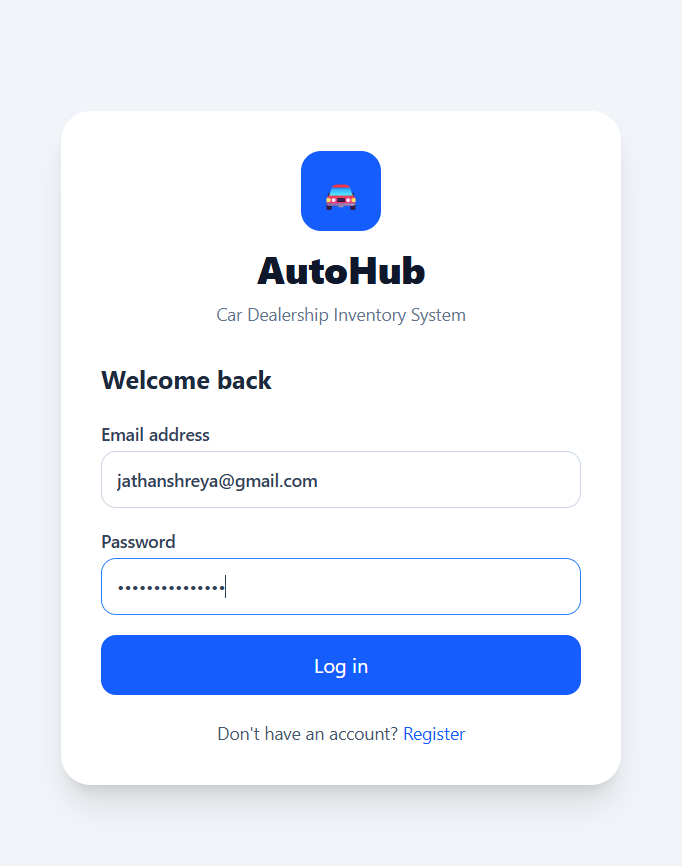
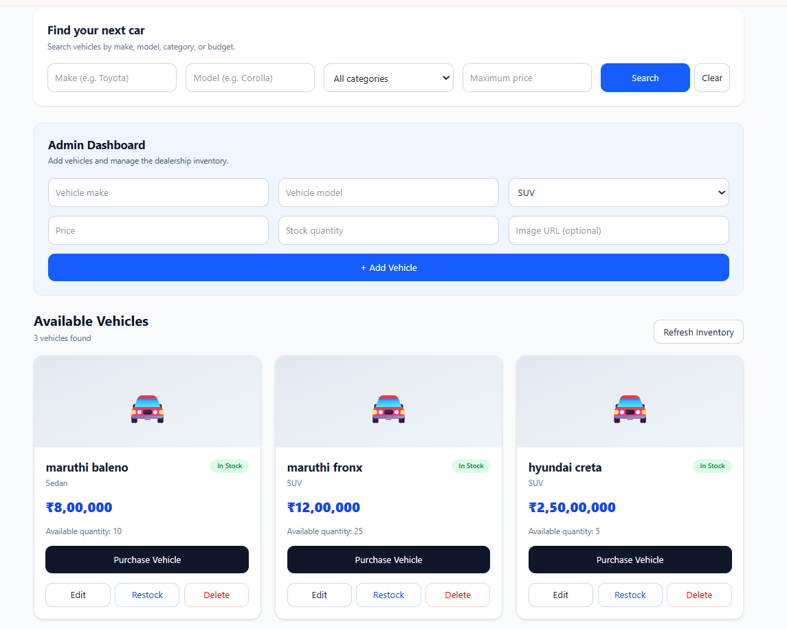
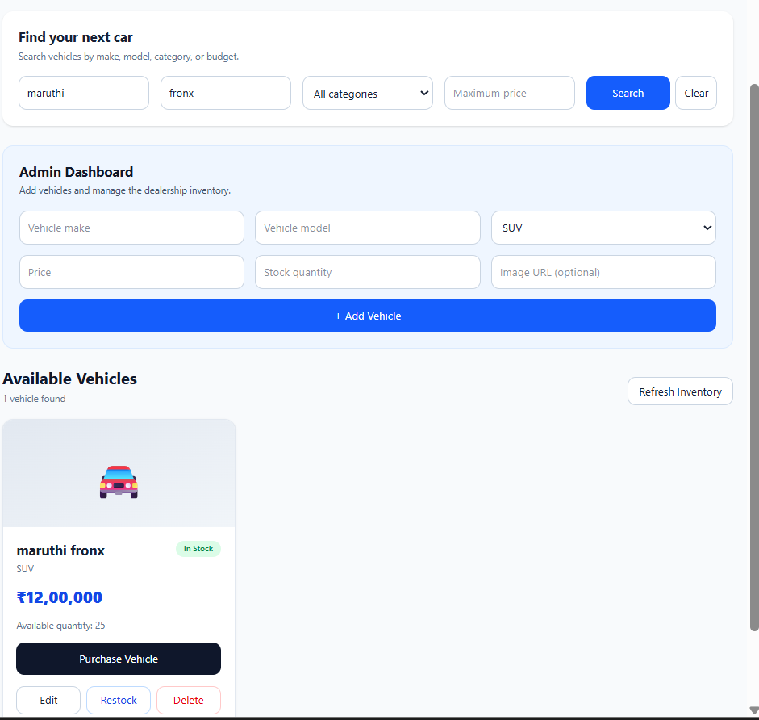
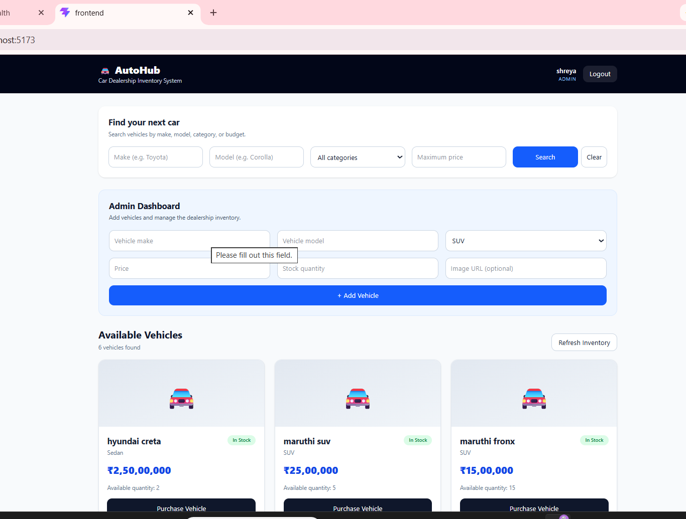

# AutoHub — Car Dealership Inventory System

AutoHub is a full-stack web application for managing a car dealership's vehicle inventory. Customers can register, log in, browse vehicles, search for vehicles, and purchase available stock. Administrators can add, edit, delete, and restock vehicles.

## Features

### Authentication

* User registration and login.
* Password hashing with bcrypt.
* JWT-based authentication.
* Role-based authorization for administrator operations.

### Vehicle Inventory

* View available vehicles.
* Search by make, model, and category.
* Filter vehicles by maximum price.
* Add new vehicles.
* Update vehicle details.
* Delete vehicles.
* Purchase vehicles and decrease stock.
* Restock vehicles with a positive quantity.
* Prevent purchases when stock is unavailable.

### Security

* Passwords are hashed before storage.
* Protected API endpoints require a valid JWT.
* Administrator-only operations are protected by role checks.
* SQL queries use parameterized statements.
* Environment variables are used for configuration.

## Technology Stack

**Frontend**

* React
* Vite
* Tailwind CSS

**Backend**

* Node.js
* Express.js
* JSON Web Tokens
* bcrypt

**Database**

* SQLite using better-sqlite3

**Testing**

* Jest
* Supertest

## Project Structure

```text
car-dealership-inventory/
├── backend/
│   ├── src/
│   │   ├── config/
│   │   ├── middleware/
│   │   ├── routes/
│   │   ├── services/
│   │   ├── app.js
│   │   └── server.js
│   ├── tests/
│   │   ├── auth.test.js
│   │   └── vehicle.test.js
│   ├── .env
│   └── package.json
├── frontend/
│   ├── src/
│   ├── package.json
│   └── vite.config.js
├── screenshots/
├── PROMPTS.md
└── README.md
```

## Prerequisites

Install:

* Node.js and npm
* A code editor such as Visual Studio Code

## Installation and Setup

### 1. Clone the repository

```bash
git clone YOUR_GITHUB_REPOSITORY_URL
cd car-dealership-inventory
```

Replace `YOUR_GITHUB_REPOSITORY_URL` with the actual repository URL.

### 2. Configure the backend

```bash
cd backend
npm install
```

Create a `.env` file inside `backend/`:

```env
PORT=5000
JWT_SECRET=replace_with_a_long_random_secret
ADMIN_NAME=Administrator
ADMIN_EMAIL=admin@example.com
ADMIN_PASSWORD=replace_with_a_unique_password_of_at_least_12_characters
```

Use your own secure values. Never commit `.env` to GitHub.

### 3. Create the administrator account

From the `backend/` directory, run:

```bash
node src/config/createAdmin.js
```

The script creates the administrator if the configured email does not already exist.

### 4. Start the backend

```bash
npm start
```

The API runs at:

`http://localhost:5000`

Health check:

`http://localhost:5000/api/health`

### 5. Start the frontend

Open another terminal:

```bash
cd frontend
npm install
npm run dev
```

Open the local URL printed by Vite, usually:

`http://localhost:5173`

## API Endpoints

All vehicle endpoints require a valid JWT in the Authorization header.

| Method | Endpoint                     | Access        | Purpose                  |
| ------ | ---------------------------- | ------------- | ------------------------ |
| POST   | `/api/auth/register`         | Public        | Register a user          |
| POST   | `/api/auth/login`            | Public        | Log in and receive a JWT |
| GET    | `/api/health`                | Public        | Check API status         |
| GET    | `/api/vehicles`              | Authenticated | List vehicles            |
| GET    | `/api/vehicles/search`       | Authenticated | Search vehicles          |
| POST   | `/api/vehicles`              | Admin         | Add a vehicle            |
| PUT    | `/api/vehicles/:id`          | Admin         | Update a vehicle         |
| DELETE | `/api/vehicles/:id`          | Admin         | Delete a vehicle         |
| POST   | `/api/vehicles/:id/purchase` | Authenticated | Purchase a vehicle       |
| POST   | `/api/vehicles/:id/restock`  | Admin         | Restock a vehicle        |

### Example authenticated request

```http
GET /api/vehicles
Authorization: Bearer YOUR_JWT_TOKEN
```

## Running Tests

From the `backend/` directory:

```bash
npm test
```

For coverage:

```bash
npm run test:coverage
```

The tests cover authentication and vehicle operations. Check the actual test output before reporting the final number of passing tests.

## Screenshots

Application screenshots are stored in the `screenshots/` directory.

Add screenshots showing:

* Login and registration pages.
* Vehicle inventory dashboard.
* Vehicle search results.
* Administrator add/edit operations.
* Restocking and purchasing.
* Automated test results.

## Test-Driven Development

The project uses Jest and Supertest to test the REST API.

For features developed using TDD, document the actual sequence:

1. Write a failing test.
2. Implement the minimum code required to pass it.
3. Run the test suite.
4. Refactor while keeping tests green.

The development history should accurately reflect which features followed this process.

## AI Usage

AI tools were used as development assistance for implementation guidance, debugging, and documentation. The final implementation and test results should be reviewed and understood by the developer.

See `PROMPTS.md` for the prompts and AI interaction records required for this assessment.

## Future Improvements

* Pagination for large inventories.
* Vehicle image upload.
* Purchase history and transaction records.
* More comprehensive automated testing.
* Improved deployment configuration.


## Application Screenshots

### Login Page



### Vehicle Inventory



### Search and Filter



### Admin Dashboard



### Backend Test Results


